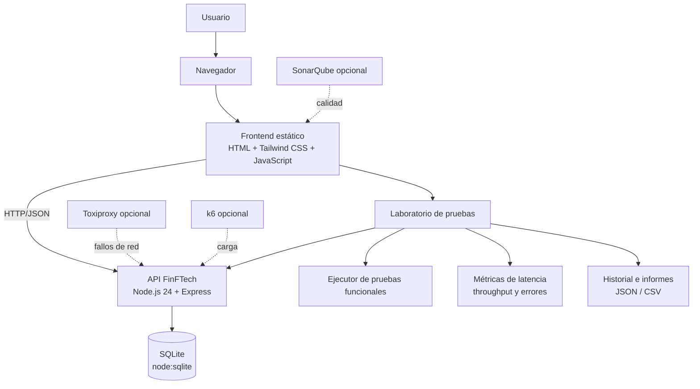

# FinFTech

**FinFTech** es un laboratorio de simulación de carga y tolerancia a fallos para una API
que representa operaciones de una billetera digital. Permite ejecutar pruebas funcionales y
de rendimiento, inyectar latencia y fallos controlados, medir latencia/throughput/errores,
prevenir transferencias duplicadas mediante idempotencia y consultar el historial con
exportación de informes.

> Interfaz basada en los 8 diseños aprobados de Google Stitch (marca unificada como
> **FinFTech**).

---

## Arquitectura



- **API**: Node.js 24 + Express. Sin ORM: usa el módulo nativo `node:sqlite` (no requiere
  compilar dependencias nativas).
- **Persistencia**: SQLite en `backend/data/finftech.db` (volumen `/data` en Docker).
- **Frontend**: páginas estáticas generadas desde el diseño de Stitch (`frontend/build.js`)
  + un runtime JS propio que consume la API real.

## Tecnologías

| Capa | Tecnología |
|------|------------|
| API | Node.js 24, Express 4 |
| Persistencia | SQLite (`node:sqlite`, nativo) |
| Frontend | HTML + Tailwind (CDN del diseño) + JS vanilla |
| Contenedores | Docker, Docker Compose (nginx para el frontend) |
| Carga | k6 |
| Fallos de red | Toxiproxy |
| Calidad | Pruebas con `node:test`; SonarQube (perfil opcional) |
| CI | GitHub Actions |

## Estructura del repositorio

```text
FinFTech/
├── backend/                 API Express
│   ├── src/                 aplicación, rutas, servicios y middleware
│   ├── tests/               pruebas unitarias e integración
│   └── Dockerfile
├── frontend/                interfaz y servidor estático
│   ├── build.js             genera public/ desde _stitch_source
│   └── public/              páginas y assets del runtime
├── k6/                      escenarios de carga y caos
├── toxiproxy/               configuración de proxies
├── _stitch_source/          diseños originales de referencia
├── docker-compose.yml
├── .env.example
└── README.md
```
## Requisitos

- **Con Docker (recomendado)**: Docker + Docker Compose.
- **Sin Docker (permitido para desarrollo)**: Node.js ≥ 22.5 (probado con Node 24) y npm.

## Configuración de variables

Copia `.env.example` a `.env` y ajusta los valores (no versiones el `.env`). Las variables
principales: `PORT`, `DB_PATH`, `TOKEN_SECRET`, `ADMIN_EMAIL`, `ADMIN_PASSWORD`,
`CORS_ORIGINS` y, para k6, `K6_BASE_URL`, `K6_LOAD_VUS`, `K6_LOAD_DURATION`,
`K6_P95_MS`, `K6_ERROR_RATE`, `K6_PROXY_URL`, `TOXIPROXY_ADMIN`,
`K6_TOXIPROXY_LATENCY_MS` y `K6_TOXIPROXY_RATE_KB`.

> No uses los nombres `K6_VUS` / `K6_DURATION`: k6 los interpreta como opciones globales y
> sobrescriben las opciones por escenario del script. Ver [`k6/README.md`](k6/README.md).

## Iniciar el entorno

### Con Docker Compose

```bash
cp .env.example .env
# OBLIGATORIO: generar un secreto propio para firmar los tokens (mínimo 16 caracteres):
#   openssl rand -hex 32   -> pegar el resultado en TOKEN_SECRET del .env
# La API se niega a arrancar en producción con un valor de ejemplo; para aceptar el
# riesgo de forma consciente: ALLOW_INSECURE_DEFAULTS=1.
docker compose up --build -d
```

| Servicio | URL | Puerto |
|----------|-----|--------|
| Frontend | http://localhost:8080 | 8080 |
| API | http://localhost:3000 | 3000 |
| Toxiproxy (proxy) |  | 8666 |
| Toxiproxy (admin, solo local) | http://localhost:8474 | 8474 |
| SonarQube (perfil `quality`) | http://localhost:9000 | 9000 |

### Sin Docker (desarrollo local)

```bash
# 1) API
cd backend
npm ci
npm run seed
npm start                     # http://localhost:3000

# 2) Frontend (otra terminal)
cd frontend
npm run build                 # genera public/ desde _stitch_source
npm start                     # http://localhost:8080
```

El frontend apunta por defecto a `http://<host>:3000`. Puede cambiarse con
`localStorage['finftech.apiBase']` o editando `frontend/public/assets/js/config.js`.

## Verificar la salud de la API

```bash
curl http://localhost:3000/health
# -> { "status": "healthy", "product": "FinFTech", "checks": { "api": "ok", "database": "ok" } }
```

## Ejecutar las pruebas

### Pruebas automatizadas (unitarias + integración)

```bash
cd backend
npm test
```

Cubren: salud, login, transferencia válida, replays idempotentes, conflicto 409 por
reutilización de clave con cuerpo distinto, saldo insuficiente (422), validaciones (400),
**reintentos concurrentes con la misma clave** (una sola transferencia) y **concurrencia
sin saldo negativo**.

### Escenarios de carga (k6)

```bash
K6_SCENARIO=functional  docker compose --profile load run --rm k6-run
K6_SCENARIO=load        K6_LOAD_VUS=20 K6_LOAD_DURATION=30s docker compose --profile load run --rm k6-run
K6_SCENARIO=concurrency docker compose --profile load run --rm k6-run
K6_SCENARIO=ramp        docker compose --profile load run --rm k6-run
K6_SCENARIO=idempotency docker compose --profile load run --rm k6-run

# Fallo a nivel de aplicación (/api/chaos)
K6_SCENARIO=latency     docker compose --profile load run --rm k6-run
K6_SCENARIO=outage      docker compose --profile load run --rm k6-run
K6_SCENARIO=recovery    docker compose --profile load run --rm k6-run

# Fallo a nivel de RED (el tráfico atraviesa Toxiproxy)
K6_SCENARIO=toxiproxy-baseline  docker compose --profile load run --rm k6-run
K6_SCENARIO=toxiproxy-latency   docker compose --profile load run --rm k6-run
K6_SCENARIO=toxiproxy-bandwidth docker compose --profile load run --rm k6-run
K6_SCENARIO=toxiproxy-outage    docker compose --profile load run --rm k6-run
K6_SCENARIO=toxiproxy-recovery  docker compose --profile load run --rm k6-run
```

Los resultados se conservan por escenario en `k6/results/summary-<escenario>.json` y
`k6/results/stream-<escenario>.json`. Detalle en [`k6/README.md`](k6/README.md).

### Análisis estático (SonarQube, perfil `quality`)

```bash
docker compose --profile quality up -d            # sonar-db + sonarqube (http://localhost:9000)

# Cobertura de las pruebas del backend en formato LCOV
cd backend
node --test --experimental-test-coverage \
  --test-reporter=lcov --test-reporter-destination=coverage/lcov.info \
  tests/integration/api.test.js tests/unit/wallet.test.js
cd ..

# Token de análisis (la primera vez hay que cambiar la contraseña de `admin`)
curl -s -u admin:admin -X POST "http://localhost:9000/api/users/change_password?login=admin&password=<nueva>&previousPassword=admin"
TOKEN=$(curl -s -u admin:<nueva> -X POST "http://localhost:9000/api/user_tokens/generate?name=finftech-cli" | jq -r .token)

# Análisis
docker compose --profile quality run --rm -e SONAR_TOKEN="$TOKEN" sonar-scanner
```

La configuración vive en [`sonar-project.properties`](sonar-project.properties) y el
LCOV se enlaza con `sonar.javascript.lcov.reportPaths`.

## Historial, métricas e informes

- **En la interfaz**: *Performance overview* (métricas en vivo), *History & Reports*
  (listado, detalle, comparación y exportación).
- **API**:
  - `GET /api/metrics`  latencia (avg/p50/p90/p95/p99), throughput, errores.
  - `GET /api/runs?limit=50`  historial.
  - `GET /api/history/compare?ids=A,B`  comparación con deltas.
  - `GET /api/runs/:id/report.json` · `GET /api/runs/:id/report.csv`  informe de una ejecución.
  - `GET /api/history/export.csv` · `GET /api/history/export.json`  historial completo.

Resultados posibles de una ejecución: `passed` (satisfactorio), `degraded` (degradado),
`failed` (fallido), `incomplete` (incompleto) y `cancelled` (cancelado). Cada escenario de
fallo tiene **criterios explícitos** (por ejemplo, *recovery* exige observar el fallo y su
recuperación), por lo que "prueba ejecutada" no se confunde con "sistema validado".

## Idempotencia de transferencias

`POST /transfer` requiere el encabezado `Idempotency-Key` (o el campo `idempotencyKey`):

- Misma clave + mismo cuerpo → **replay** (200) con el resultado original, sin doble efecto.
- Misma clave + cuerpo distinto → **409 Conflict**.
- La operación se ejecuta en una transacción `BEGIN IMMEDIATE` y el débito usa una
  actualización condicional (`balance_cents >= monto`), por lo que **nunca hay saldo negativo**
  ni transferencias duplicadas bajo concurrencia.

```bash
curl -X POST http://localhost:3000/transfer \
  -H 'Content-Type: application/json' -H 'Idempotency-Key: demo-0001' \
  -d '{"from":"acc_alice","to":"acc_bob","amount":1.5}'
```

## Latencia y fallos controlados

Sin Docker, la inyección se hace **a nivel de aplicación** (sustituto de Toxiproxy), desde
la pantalla *Settings* o por API:

```bash
curl -X POST http://localhost:3000/api/chaos/latency -H 'Content-Type: application/json' -d '{"ms":300,"jitterMs":100}'
curl -X POST http://localhost:3000/api/chaos/failure -H 'Content-Type: application/json' -d '{"rate":1}'
curl -X POST http://localhost:3000/api/chaos/reset
```

Con Docker, además puede usarse **Toxiproxy** para fallos a nivel de red
(ver [`k6/README.md`](k6/README.md)).

## Detener el entorno sin perder datos

```bash
docker compose down            # conserva el volumen finftech-data (SQLite)
# NO usar `-v`: eliminaría el volumen y la base de datos.
```

Los datos persisten en el volumen `finftech-data` (API).

## Logs y diagnóstico

```bash
docker compose logs -f api        # logs JSON de la API
docker compose ps                 # estado y salud de los servicios
curl http://localhost:3000/api/services   # estado de los componentes
```

Si un servicio no arranca, revisa `docker compose logs <servicio>` antes de reintentar.

## Demostración académica

Flujo reproducible paso a paso en [`docs/demo.md`](docs/demo.md). Evidencia de las
comprobaciones ejecutadas en [`docs/verificacion.md`](docs/verificacion.md).

## Limitaciones conocidas

- **Docker sí está disponible y verificado**: API, frontend (Nginx), Toxiproxy, k6
  (13 escenarios) y SonarQube se han construido, arrancado y ejercitado en Docker Compose.
  La evidencia está en [`docs/verificacion.md`](docs/verificacion.md).
- **SonarQube** (perfil `quality`) se ejecutó con un análisis real: *quality gate* **OK**
  (ratings A/A/A), `0` bugs, `0` vulnerabilidades, `9` *code smells* y cobertura de línea
  ~53 % (LCOV de las pruebas del backend). Requiere ~2 GB de RAM y arranca en ~40 s.
- **Los fallos de aplicación (`/api/chaos/*`) y los de red (Toxiproxy) son mecanismos
  distintos**: el primero actúa en el proceso de la API (funciona sin Docker); el segundo
  interrumpe el tráfico a nivel de red a través del proxy `finftech_api`.
- No se implementan (se muestran como *no disponibles* en la interfaz): SSO (Okta/SAML),
  webhooks, SLA guardrails, API keys/CLI y gestión de equipos.
- No se declara cumplimiento de normas ISO: solo se aplican prácticas técnicas concretas.
